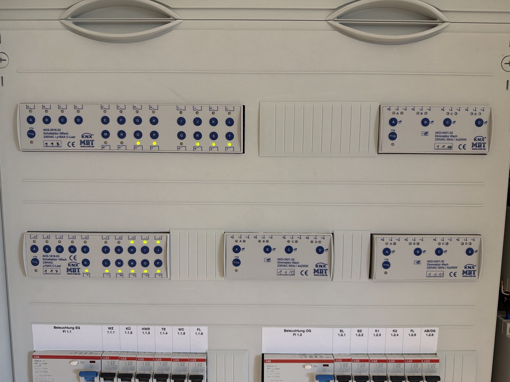

Als wir 2021 mit dem Bau unseres Hauses angefangen haben, stand eines früh fest: Es wird KNX. Die Elektroplanung habe ich selbst gemacht und den größten Teil auch selbst verdrahtet. Rund fünf Jahre und eine ETS-Inventur später lohnt sich ein Blick zurück, was sich bewährt hat.

## Leitung überall hin

Der wichtigste Grundsatz war, KNX-Leitung an jede Stelle zu legen, an der sie irgendwann gebraucht werden könnte. Nachträglich ziehen ist teuer und schmutzig, ein ungenutztes Kabel in der Decke kostet fast nichts.

- An nahezu jeder Lampengruppe liegt ein Ausläufer der Busleitung. So lassen sich Präsenz-, Bewegungs- oder Rauchmelder später ohne Stemmarbeiten nachrüsten.
- Jeder Raum hat mindestens eine KNX-Leitung für den Taster.
- Zwei Räume haben bewusst keinen Taster: Im Gäste-WC und im Technikraum schaltet ein Bewegungsmelder in der abgehängten Decke das Licht, die Temperatur messen dort Zigbee-Sensoren.

## Sternförmig verdrahtet

Jeder Raum ist sternförmig angefahren, mit eigenen Zuleitungen für Licht, Rollläden und Steckdosen. Große Verbraucher haben eine eigene Zuleitung. Das macht den Verteiler voll, hat aber einen großen Vorteil: Jeder Kanal ist einzeln schalt- und messbar, und für eine Änderung muss ich nur im Verteiler umklemmen.

Im Verteiler stecken heute:

- zwei Schaltaktoren mit 20 und 16 Kanälen für Licht und Steckdosen
- ein Schaltaktor mit Strommessung für Waschmaschine, Trockner, Multimedia und die Brauchwasserpumpe
- drei Dimmaktoren mit je vier Kanälen
- drei Jalousieaktoren für die Rollläden
- zwei Heizungsaktoren für die Stellantriebe der Fußbodenheizung
- ein Universalaktor für Außenleuchten, Garagenlicht und das Tor
- der Gira X1 und der Gira S1

Hinter einem Linienkoppler laufen zwei Linien. Die zweite versorgt alles außerhalb des Hauses.

## Gruppenadressen mit System

Rund 600 Gruppenadressen sind es geworden. Damit das überschaubar bleibt, hat jede Hauptgruppe ein Thema: Licht, Heizung, Rollläden, Reedkontakte, Meldungen, Logik und Sonstiges wie Wetter und Verbrauch. Darunter folgt in jeder Hauptgruppe dieselbe Logik, etwa Schalten, Dimmen und Rückmeldung bei der Beleuchtung.

Mein Tipp: Legt die Zentralfunktionen von Anfang an mit an. Eine Adresse für „alles aus“ oder für alle Rollläden einer Fassade ist bei der Programmierung schnell erledigt und später Gold wert, weil ein einziges Telegramm viele Kanäle schaltet.

## Wie wir das Haus bedienen

Im Januar habe ich die Bedienung noch so aufgeschrieben:

1. Taster und Präsenzmelder
2. Apple Home auf iPhone, iPad und Mac
3. die Gira-App und das Türpanel
4. Home Assistant, damals noch als Experiment

Heute sieht die Reihenfolge anders aus. Die Taster sind weiterhin die erste Wahl und funktionieren ohne jeden Server. Apple Home hängt aber inzwischen an Home Assistant, über fünf HomeKit-Bridges mit festen Listen. Home Assistant ist vom Experiment zur Zentrale geworden.

## Was erst später auffiel

Beim Abgleich der ETS mit Home Assistant im Oktober kamen ein paar Dinge zutage, die ihr bei eurer eigenen Inbetriebnahme gleich mitprüfen könnt:

- **Verpolte Reedkontakte:** An einem Küchenfenster waren die Kontakte verkehrt herum ausgewertet. Der Jalousieaktor hielt das Fenster für offen und sperrte die Abwärtsfahrt des Rollladens.
- **Gleich benannte Adressen:** Zwei Gruppenadressen trugen denselben Namen, die Visualisierung schaltete die eine, Home Assistant die andere.
- **Falsch beschriftete Kanäle:** Der Messkanal „Dunstabzug“ hat in Wahrheit den Trockner gemessen.

[…weitere Erfahrungen aus der Bauphase: Was würdest du heute anders machen?]

## Fazit

[…eigenes Fazit]

## Fortsetzung folgt…
