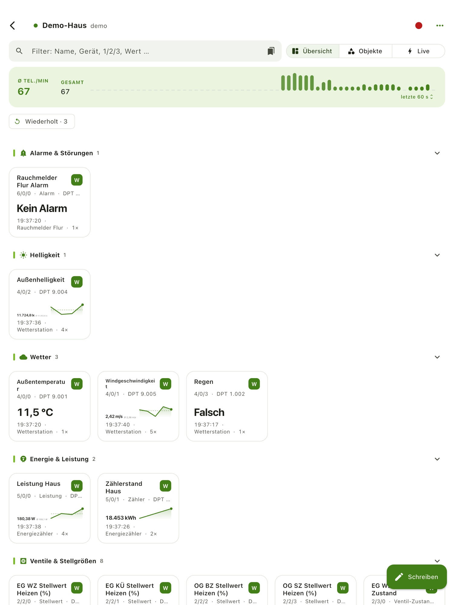
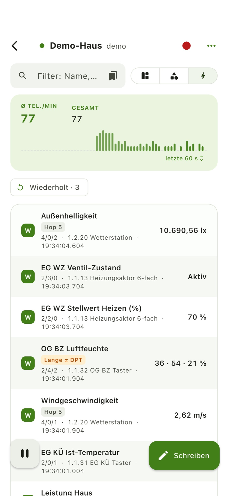
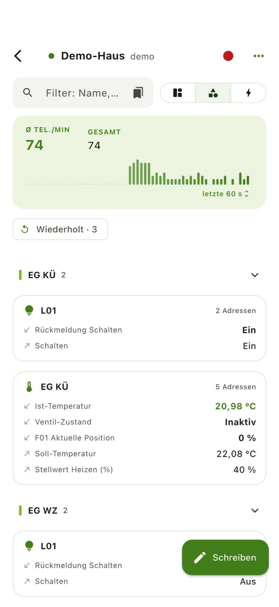
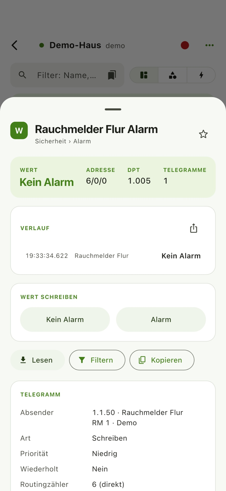
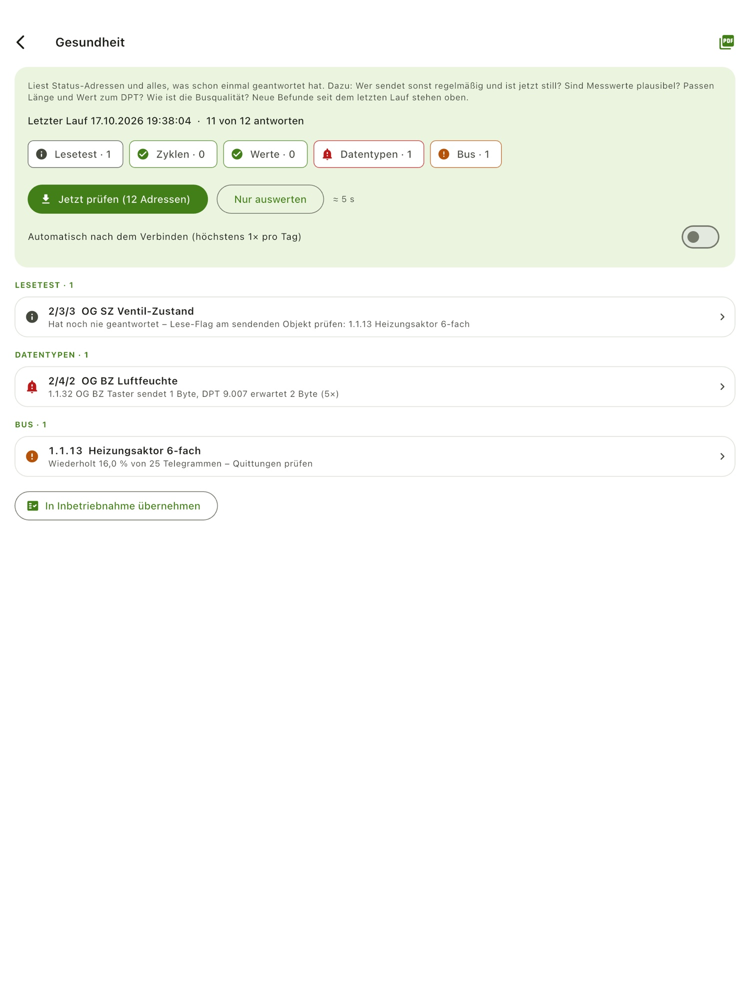
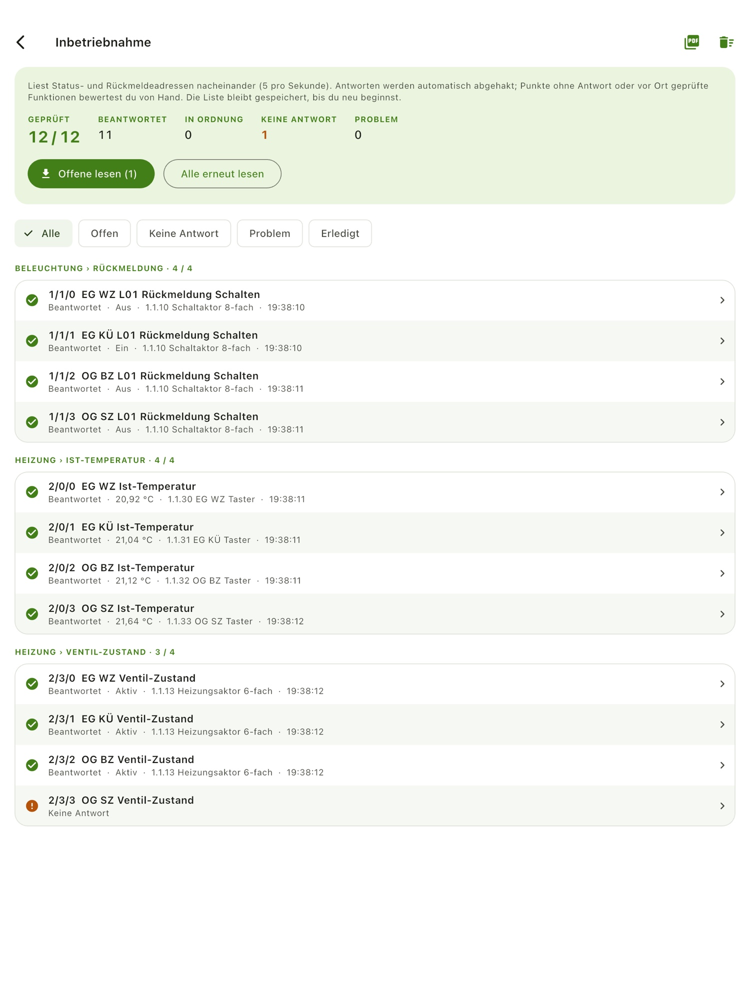

Seit wir in unser Haus mit KNX eingezogen sind, will ich immer wieder kurz wissen, was gerade auf dem Bus passiert. Welcher Taster hat gesendet, antwortet der Heizungsaktor noch, warum fährt der Rollladen nicht? Die ETS kann das, aber dafür muss der Windows-Rechner hochfahren. Also habe ich mir eine App gebaut, die genau das auf dem iPad und iPhone zeigt.

## Klein angefangen

Der erste Wunsch war bescheiden: einen minimalistischen KNX-Client mit Flutter, die IP-Adresse des Gateways eingeben und dann den Gruppenmonitor sehen. Gebaut habe ich die App zusammen mit Claude Code, so wie zuvor schon die Wartung dieses Blogs, über die ich [hier](/blog/wie-claude-die-wartung-meines-blogs-vereinfacht/) geschrieben habe.

Aus dem kleinen Client wurde schnell mehr. Nach vier Tagen und knapp 70 Commits steht eine App mit eigener KNXnet/IP-Implementierung, also ohne zusätzliche KNX-Bibliothek, die auf iPhone, iPad, Android, dem Desktop und im Browser läuft. Jeder Schritt war eine kurze Iteration: ausprobieren, sagen, was stört, und kurz darauf die nächste Version testen.

## Die Übersicht

Nach dem Verbinden zeigt die App für jede Gruppenadresse den letzten Wert als Karte mit Mini-Verlauf. Die Karten sind nach Messgröße sortiert, also Helligkeit, Wetter, Energie oder Ventile, dazu nach den Hauptgruppen aus der ETS. Was man oft braucht, lässt sich oben anheften.

Damit die Namen stimmen, liest die App das ETS-Projekt ein, als `.knxproj` (ETS5 und ETS6, auch mit Passwort) oder als Export der Gruppenadressen in CSV. Übernommen werden Namen, Datenpunkttypen mit Einheiten, Geräte mit Raum und die Verknüpfungen der Kommunikationsobjekte. Das Passwort des Projekts speichert die App nicht.

## Live, Objekte und Details

Neben der Übersicht gibt es zwei weitere Blickwinkel auf denselben Bus:

- **Live** listet jedes Telegramm mit Absender, Wert und Zeitstempel und markiert Auffälligkeiten, etwa Wiederholungen oder eine Datenlänge, die nicht zum Datenpunkttyp passt
- **Objekte** fasst Befehle und Rückmeldungen zu Räumen und Objekten zusammen, damit Licht, Heizung und Rollladen eines Raums beieinander stehen
- **Details** zeigen den Verlauf einer Adresse, erlauben das Lesen und Schreiben eines Werts und verraten, wer gesendet hat





Für die Fehlersuche gibt es zusätzlich einen Busmonitor, der alle Frames auf der Leitung samt Quittungen zeigt, und Aufnahmen, die sich später zeitgetreu wiedergeben lassen.

## Gesundheit und Inbetriebnahme

Zwei Werkzeuge gehen über einen reinen Monitor hinaus. Die **Gesundheit** liest bekannte Status-Adressen und meldet, wer neu schweigt. Dazu prüft sie, ob zyklische Sender noch regelmäßig senden, ob Messwerte plausibel sind und ob Länge und Wert zum Datenpunkttyp passen. Das Ergebnis gibt es auch als PDF.

Die **Inbetriebnahme** ist eine Checkliste aller Status- und Rückmeldeadressen. Die App liest sie nacheinander, Antworten werden automatisch abgehakt. Was keine Antwort liefert oder vor Ort geprüft werden muss, bewertet man von Hand, mit Notiz. Am Ende steht ein PDF-Protokoll mit Unterschriftsfeld.





## Diagnose und Topologie

Für alles, was tiefer geht, gibt es eine Reihe kleinerer Werkzeuge:

- Geräte im Programmiermodus finden und physikalische Adressen prüfen, wie in der ETS
- Linienscan und Geräteinformationen
- Topologie mit Linien, Kopplern und linienübergreifendem Verkehr
- Eine Kommunikationskarte, die zeigt, wer mit wem spricht
- Projektabgleich, Statistik und Export als PDF, CSV oder im ETS-Format

## Lokal und ohne Konto

Die App braucht kein Konto, keine Cloud und kein Tracking. Sie spricht nur mit dem Gateway im eigenen Netzwerk, alles andere bleibt auf dem Gerät. Voraussetzung ist eine KNX-IP-Schnittstelle oder ein IP-Router mit freiem Tunnel, z. B. ein Gira X1. KNX Secure wird noch nicht unterstützt.

Wer keine Anlage zur Hand hat, kann die App im Demo-Modus mit einem erfundenen Musterhaus ausprobieren. Aus diesem Modus stammen auch alle Bilder in diesem Beitrag.

## Auch in Home Assistant

Die App läuft außerdem als Add-on in Home Assistant und erscheint dort in der Seitenleiste. Ein kleiner Server liefert die Web-Version aus und leitet die Telegramme zum Gateway weiter. Aufnahmen und Verlauf liegen im Datenordner des Add-ons, Alarme kommen als Benachrichtigung aufs Handy. Installiert wird das Add-on über ein eigenes Add-on-Repository, nicht über HACS, weil HACS keine Add-ons verteilt.

## Wie es weitergeht

Die Einreichung im App Store und im Play Store ist vorbereitet, ebenso das Add-on-Repository und eine eigene Seite zur App. Sobald alles verfügbar ist, ergänze ich hier die Links. Auf meiner Liste stehen danach vor allem KNX Secure und Rückmeldungen von euch, also gerne ausprobieren und schreiben, was fehlt.
