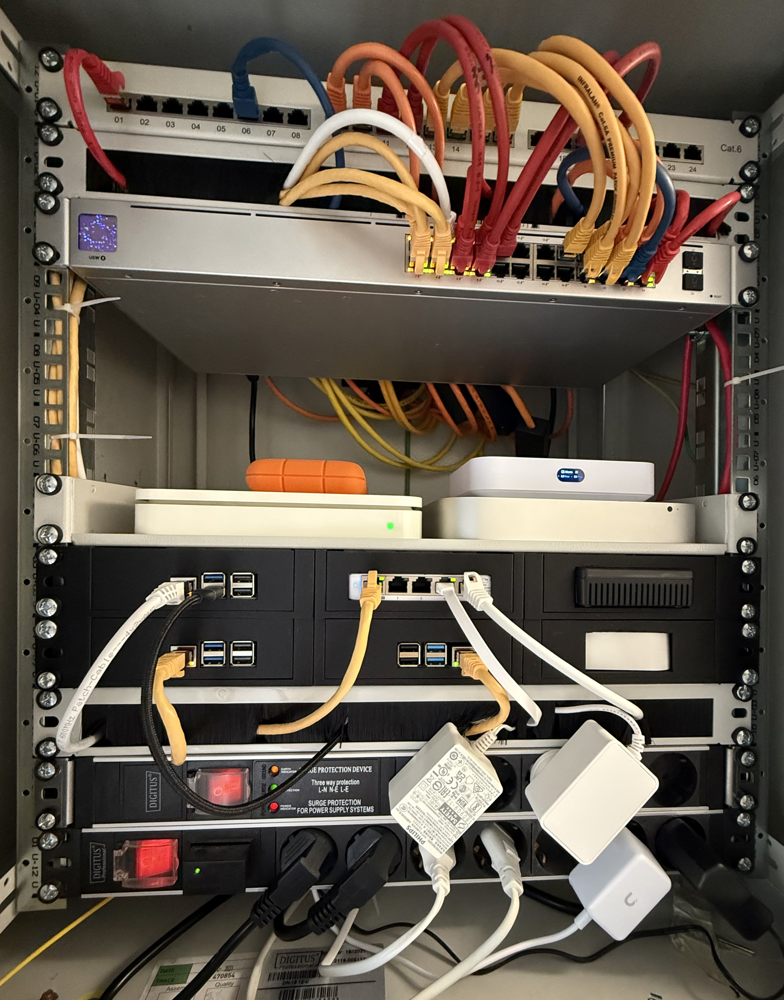

Im November 2024 habe ich [unseren Netzwerk-Aufbau](/blog/aktueller-netzwerk-aufbau/) beschrieben: Glasfaser, Fritz!Box, zwei Raspberry Pis und ein PoE-Switch. Von der Fritz!Box ist inzwischen nichts mehr übrig, und im Oktober habe ich den Schrank zum ersten Mal richtig ausgemistet. Höchste Zeit für einen neuen Stand.

## Der Stand vor dem Aufräumen

Das Foto unten stammt aus dem November 2025. Von oben nach unten war damals verbaut:

- 24-Port-Patchfeld
- UniFi Switch mit 24 PoE-Ports
- Apple Time Capsule als Backup- und Dateiserver
- UniFi Cloud Gateway, das die Fritz!Box abgelöst hat
- ein Mac mini von 2014 als Time-Machine-Server
- drei Raspberry Pis mit PoE-HATs: Home Assistant, HKKNX und Pi-hole
- ein kleiner UniFi-Switch für die Bridges im Haus
- das Glasfasermodem und die Hue-Bridge

Gewachsen ist das über die Jahre Stück für Stück. Jedes Gerät hatte beim Einzug seinen Grund, nur hat niemand nachgesehen, ob der Grund noch besteht.

## Erst messen

Vor den Schrank habe ich einen Shelly-Zwischenstecker gesetzt, der vorher die Weihnachtsdeko geschaltet hat. Daran hängen Modem, Gateway und der große Switch, und über den Switch per PoE alles andere: die Pis, die Access Points im Haus und das Türpanel. Der Schalter des Steckers ist in Apple Home ausgeblendet. Es soll niemand beim Aufräumen der Szenen versehentlich das Internet abschalten.

Nachdem Time Capsule und Mac mini raus waren, zeigte der Stecker rund 67 W. Das klingt wenig, läuft aber rund um die Uhr: Bei 33 Cent je Kilowattstunde sind das etwa 190 € im Jahr. […Verbrauch vor dem Ausbau von Time Capsule und Mac mini, falls bekannt]

## Drei Geräte weniger

Die Frage war bei jedem Gerät dieselbe: Was macht es heute noch, das nicht schon ein anderes erledigt?

- **Time Capsule und Mac mini:** […kurz, wohin die Backups gezogen sind]
- **Pi-hole:** Der Werbeblocker lief als DNS-Server im Gateway. Am 14. Oktober habe ich seinen PoE-Port abgeschaltet. Danach stand der Schrank bei rund 60 W, also etwa 172 € im Jahr.
- **HKKNX:** Die Bridge hat KNX in Apple Home gebracht. Das erledigt inzwischen Home Assistant mit fünf HomeKit-Bridges, also ging der Pi am 16. Oktober vom Netz.

Von drei Raspberry Pis läuft damit nur noch einer, ein Pi 5 mit Home Assistant und einer NVMe-SSD.

## Was UniFi anzeigt und was der Stecker misst

Die UniFi-Oberfläche zeigt für jeden PoE-Port, was das Gerät daran zieht. Der Pi-hole stand dort mit 5,7 W, HKKNX mit 4,0 W. Am Shelly war die Ersparnis jeweils etwa ein Fünftel größer. Das sind die Verluste im Netzteil des Switch, die UniFi pro Port nicht mitrechnet.

Wenn ihr also überlegt, ob sich das Abschalten eines kleinen Geräts lohnt: Rechnet mit etwas mehr, als die Port-Anzeige verspricht.

## Neu dazugekommen

Ganz ohne Zuwachs ging es nicht. Im Zählerschrank hängen zwei Tasmota-Leseköpfe an den Stromzählern, und die sind immer wieder aus dem WLAN gefallen. Kein Wunder bei −79 dBm. Seit Mitte Oktober hängt dort provisorisch ein kleiner UniFi Access Point, und die Leseköpfe melden sich mit −27 und −30 dBm. Für den AP plane ich einen Halter für die Hutschiene aus dem 3D-Drucker.

## Momentaner Stand

- Glasfasermodem, UniFi Cloud Gateway und der 24-Port-PoE-Switch im Schrank
- ein Raspberry Pi 5 mit Home Assistant
- Access Points auf allen Etagen […und in der Garage oder am Zählerschrank?], alle per PoE
- ein kleiner Switch für die Bridges
- […Time Capsule: noch da oder nicht?]

Und der Verbrauch: […aktuellen Wert vom Shelly eintragen, nach dem HKKNX-Abbau grob 55 W]

## Wie es weitergeht

Der Schrank ist jetzt so leer wie seit Jahren nicht. Als Nächstes sollen die übrigen Bridges unter die Lupe, denn auch dort steckt das eine oder andere Netzteil, das nur aus Gewohnheit läuft.
